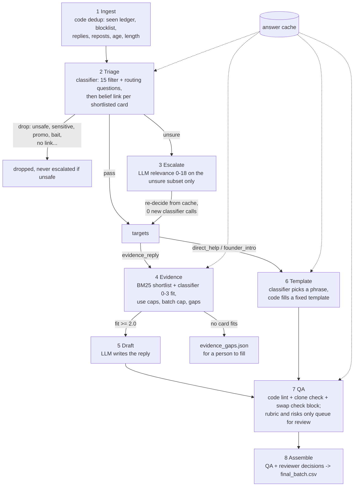

# gated-llm-pipeline

[](https://github.com/s0yabean/gated-llm-pipeline/actions/workflows/ci.yml)

An 8-step triage pipeline for a stream of inbound social posts. Code owns the control flow, a cheap
classifier makes the narrow judgment at every gate, and a reasoning model only sees the items the
classifier is unsure about. Every classifier answer is cached, and there are backtest and QA-eval
scripts to check the gates.

## The problem

A small team wants to answer a few inbound posts a day with a considered reply backed by something
it has actually done. The first version gave each post to one LLM prompt that returned a 0-18
relevance score (pass at 10). That design had four problems:

- Every post cost a reasoning-model call, including the obvious drops: promotion, bait, token shills,
  brand accounts.
- The policy lived inside the prompt. Changing a threshold meant re-scoring everything.
- It missed good posts. In the backtest below, about 900 posts worth a reply had been scored under the
  line.
- QA was a set of rubric scores that did not separate the drafts reviewers fixed from the ones they
  passed.

## Approach

Split the work by what each part is good at:

- **Code** owns ordering, dedup, thresholds, routing, ranking, caps, templates and lint. Each rule is
  a named constant you can change and re-run.
- **A cheap classifier** answers typed questions: yes/no probabilities, choices with a distribution,
  0-N scores. Here that is Jev, TypeSafe's System One model. All questions in one request are answered
  in parallel, and the answers are cached by request hash, so re-running with new thresholds costs
  nothing.
- **A reasoning model** does two jobs only: it scores the unsure subset, and it drafts replies for
  matched (post, evidence) pairs.



The classifier is pluggable (`gated_pipeline/classifier.py`):

| `CLASSIFIER=` | What it is | Needs |
|---|---|---|
| `mock` (default) | Local, deterministic keyword and word-overlap heuristics in System One answer shapes. It exists so the flow, cache and tests run anywhere. Its numbers say nothing about Jev. | nothing |
| `jev` | TypeSafe System One over HTTP, pinned to `jev-1.13.0`, or Vercel AI Gateway (unversioned) | `TYPESAFE_API_KEY` or `AI_GATEWAY_API_KEY` |

The LLM works the same way: `LLM=mock` (default) or `LLM=claude` (official `anthropic` SDK,
`CLAUDE_MODEL` overrides the model id).

## Results

These numbers were measured in the original private pipeline on 2026-09-24, on real posts. They are
copied from its backtest and QA-benchmark notes. They are **not** reproduced by the synthetic data in
this repo. The original answered posts on X (Twitter). This repo uses neutral names.

**Triage backtest** (`analysis/backtest.py` here; same method). 10,285 unique posts collected over
6 days were compared with the old single-prompt LLM score. The classifier run took 16,287 requests
and 47M input tokens, which cost about $2.

| | Classifier pass | Classifier review | Classifier drop |
|---|---|---|---|
| Old LLM pass (1,335) | 706 | 413 | 216 |
| Old LLM reject (8,950) | 1,746 | 2,522 | 4,682 |

- **Unsure share.** The original step notes give the unsure (escalated) share as about 32% of
  backtest posts. The final grid above has 2,935 of 10,285 (29%) in the review band. Only that subset
  needs a reasoning-model call.
- **New finds.** 1,746 posts passed the classifier after the old prompt rejected them. A hand check
  of 15 random posts per old-score band found:

  | Old score | Posts | Worth a reply in the sample |
  |---|---|---|
  | 7-9 | 524 | 13/15 |
  | 4-6 | 543 | 10/15 |
  | 0-3 | 679 | 2/15 |

  That gives an estimate of **about 900 real misses (±150, small samples)**. The 0-3 band was mostly
  weak theme-only links, so a theme-only link now needs 0.9 to pass (`THEME_ONLY_PASS`).
- **Wrong drops.** 216 posts passed the old prompt but the classifier dropped them (promo 121,
  shill 94, institutional 32). In a sample of 12, about 7 drops were right and 4-5 were wrong. That
  is why a strong evidence link now softens the promo and shill lines.

**Source rewrites.** Five search queries that had yielded nothing were rewritten and one was added.
The pass rate went from 6/74 (8%) to 19/59 (32%), with 20 more in review. That is one day and one
page per query, so it is a small sample.

**QA gate benchmark.** Labels came from what human and agent reviewers did to 923 first-version
drafts: 53 were fixed (47 edited, 6 dropped) and 870 shipped unchanged. The classifier rubric did
not separate the two groups (AUC 0.65), so in v0.3 it can only send a draft to review, never block
it.

| Gate | Fixed: blocked | Fixed: blocked or queued | Passed: blocked | Passed: blocked or queued |
|---|---|---|---|---|
| v0.2: rubric, risks and yes/no topic fit can block | 6/53 (11%) | 15/53 (28%) | 15% | 39% |
| v0.3: code + template + swap check block; rubric only queues | 36/53 (68%) | 38/53 (72%) | 7% | 17% |

**Swap check vs the old yes/no topic fit** (`analysis/eval_qa.py` here). The test set had 250 real,
untouched pairs and 250 synthetic swaps. In each swap, the reply was moved to the most similar other
post in its batch.

| | Swap check (choice over 4 posts) | Old topic fit (yes/no) |
|---|---|---|
| Synthetic swaps blocked / flagged | 84% / 96% | 63% / 84% |
| Real pairs blocked / flagged | 3% / 7% | 20% / 38% |
| 3 real mis-rotated replies flagged | 3/3 | 1/3 |

**Sensitive-topic line.** The rule is never to reply under death, grief or mental-health posts, and
the drop line is set low (0.4). On one real batch, the three sensitive posts scored 0.98, 0.83 and
0.59, and all three were dropped. The highest score among kept posts was 0.29.

**Not measured yet:** engagement on the replies that were posted, and the owner's own keep or cut
labels on a batch.

## Quickstart

You need Python 3.9 or newer. There are no dependencies and no keys, and the steps below take about
a minute.

```bash
git clone https://github.com/s0yabean/gated-llm-pipeline && cd gated-llm-pipeline
python3 -m gated_pipeline all --run demo        # steps 1-8 on 40 synthetic posts
python3 -m gated_pipeline all --run demo        # again: every classifier answer is a cache hit
python3 -m gated_pipeline backtest --run bt     # classifier vs the synthetic "old LLM score"
python3 -m gated_pipeline eval-qa --run demo    # swap check vs yes/no topic fit
python3 -m unittest discover -s tests -t .      # 30 tests, offline
```

Output of the first run, using the mock backends:

```
[1 ingest] 40 raw -> 33 kept; drops {'short': 2, 'seen': 1, 'reply': 1, 'repost': 1, 'too_old': 1, 'blocklist': 1}
[2 triage] 33 posts: {'pass': 11, 'escalate': 5, 'drop': 17}; drop reasons {...}
[3 escalate] 5 of 33 posts (15%) sent to LLM mock
[2 triage] 33 posts: {'pass': 16, 'drop': 17}
             re-decide pass: 0 new live classifier calls (rest from cache)
[4 evidence] 13 evidence_reply targets: 12 matched, 1 gaps
[5 draft] 12 evidence replies drafted by mock
[6 template] 3 template replies filled (no LLM)
[7 qa] ledger LEDGER_LOADED (3 entries); {'review': 3, 'pass': 10, 'rewrite': 2}
           rewrite @sample_studio_owner    ['clone of a shipped reply (1.00)']
[8 assemble] ship 10, held 5 -> runs/demo/final_batch.csv
```

Each run folder (`runs/<run>/`) keeps the intermediate files: `triage.json`, `escalate.json`,
`llm_scores.json`, `evidence.json`, `evidence_gaps.json`, `drafts.json`, `qa.json`, `qa.csv` and
`final_batch.csv`. You can run a single step with
`python3 -m gated_pipeline triage --run demo`.

To use the real backends, copy `.env.example` to `.env` and set `CLASSIFIER=jev` with a key, and/or
`LLM=claude` (after `pip install anthropic`). On the sample, a full Jev run is about 100 small requests.
Pass `--input your_posts.json` to triage your own batch (fields are listed in
`gated_pipeline/steps/s1_ingest.py`). On a live feed, add `--prior-days 3` to also dedup against
recent runs.

## Repo layout

```
gated_pipeline/
  classifier.py      question builders, Mock / Jev backends, disk cache, parallel ask_many
  llm.py             Mock / Claude backends: relevance score and draft
  catalog.py         evidence cards + BM25 shortlist
  text.py            tokens, BM25, 6-gram Jaccard
  steps/s1_ingest.py ... s8_assemble.py   the 8 steps
  analysis/backtest.py   classifier vs old single-LLM gate (grid, new finds, wrong drops)
  analysis/eval_qa.py    swap check vs yes/no topic fit on real and swapped pairs
data/                SYNTHETIC: 40 posts (fictional sample_* handles, example.com URLs),
                     14 evidence cards for a fictional studio, seen ledger, blocklist
tests/               policy, QA gates, ledger provenance, cache, caps, end to end
```

## Design decisions

- **Ask narrow, typed questions, and keep the policy in code.** The classifier returns `P(promo)`;
  `DROP["promo"] = 0.7` lives in Python. When the policy changed during the backtest, nothing had to
  be re-asked.
- **Escalate on uncertainty, not on everything.** Values between `REVIEW_FLOOR` and the drop line,
  borderline links and theme-only links go to the LLM. Unsafe and sensitive posts never do, because
  a reasoning call should not be spent rescuing content you will not answer.
- **Treat a disagreement as a signal.** When the classifier and the LLM disagree, the post goes to a
  human instead of one model overruling the other.
- **Select, don't generate, when the shape is fixed.** Template replies are code plus one classifier
  choice of a phrase copied from the post. There is no LLM call, so the template wording cannot
  drift.
- **Only gates with evidence behind them can block.** Lint, clone, template and swap checks block.
  Rubric and tone scores only queue a draft for review, because they did not separate good drafts
  from bad ones.
- **"Never checked" must not read as "checked and clean".** The clone check reports
  `NO_LEDGER_CONFIGURED` or `LEDGER_LOADED_EMPTY` instead of printing 0.00 (see the tests).
- **An evidence gap stays a gap.** If no card reaches a fit of 2.0, the post goes to
  `evidence_gaps.json` and is not answered with the nearest card.

## What I'd do next

- Collect real labels: the owner's keep or cut on a batch, and engagement on the replies that were
  posted. The current labels only show what the reviewers cared about.
- Treat the old LLM score and the classifier link as two votes in the live pipeline: drop when both
  reject, and send to review when they split.
- Mine the team's own notes for new evidence cards when a gap repeats. The original searched a notes
  vault for each gap and had the classifier judge each passage.
- Put the thresholds in a config file and replay the backtest on every change in CI.

## More

There is no write-up for this project yet. Other work is at [tonytonggg.com](https://tonytonggg.com).

MIT licence. All data in `data/` is synthetic.
